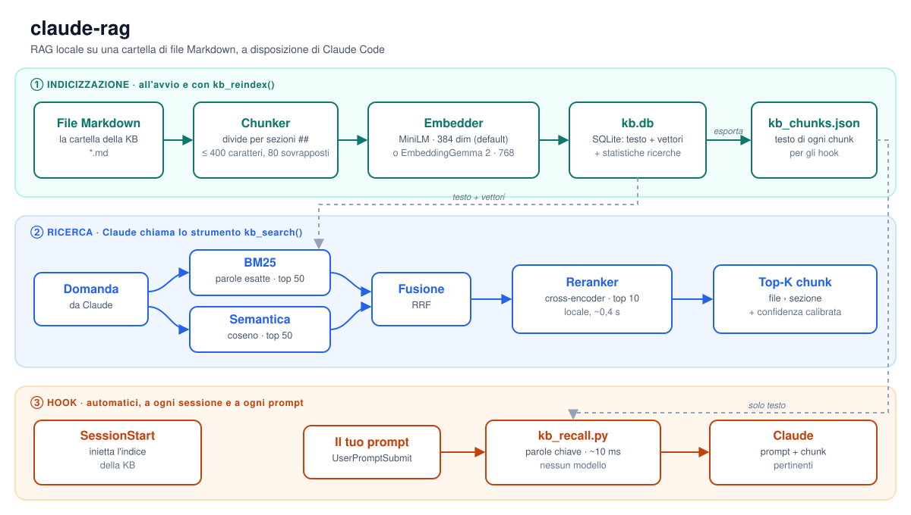

# claude-rag

**RAG locale per Claude Code su una cartella di file Markdown.**

[🇬🇧 English](README.md) · 🇮🇹 Italiano

claude-rag trasforma una cartella di note `.md` in una knowledge base che Claude Code può consultare. Gira tutto sul tuo computer: niente chiavi API, niente cloud, nessun dato che esce dal PC.

- **Strumento di ricerca**: Claude chiama `kb_search("…")` e riceve le sezioni più pertinenti, ognuna con il file di provenienza e un punteggio di confidenza.
- **Richiamo automatico** (facoltativo): gli hook aggiungono le note pertinenti al tuo prompt prima ancora che Claude lo legga.
- **Misurato, non supposto**: ogni impostazione predefinita è scelta con un benchmark di ricerca (`eval/`).



> 🔎 **[Percorso interattivo: come `kb_search` trova una risposta, passo per passo →](docs/how_search_works.html)**

---

## Indice

1. [Avvio rapido](#avvio-rapido)
2. [Cosa può fare Claude](#cosa-può-fare-claude)
3. [Come funziona](#come-funziona)
4. [Scegliere il modello di embedding](#scegliere-il-modello-di-embedding)
5. [Facoltativo: richiamo automatico con gli hook](#facoltativo-richiamo-automatico-con-gli-hook)
6. [Configurazione](#configurazione)
7. [Misurare la qualità della ricerca](#misurare-la-qualità-della-ricerca)
8. [Struttura del progetto](#struttura-del-progetto)
9. [Crediti e licenza](#crediti-e-licenza)

---

## Avvio rapido

**1. Clona il repo dentro la cartella della KB.** I file `.md` stanno nella cartella superiore.

```bash
git clone https://github.com/sangelastro/claude-rag ~/.claude/my-kb/rag
```

**2. Installa le dipendenze.**

```bash
cd ~/.claude/my-kb/rag
pip install -r requirements.txt
```

**3. Registra il server in Claude Code** (`~/.claude.json`, sotto `mcpServers`):

```json
"my-kb": {
  "command": "python",
  "args": ["/percorso/assoluto/rag/server.py"]
}
```

Se il repo non è dentro la cartella della KB, aggiungi `"env": {"KB_RAG_DIR": "/percorso/assoluto/della/kb"}`.

**4. Riavvia Claude Code.** Al primo avvio il server scarica il modello di embedding (circa 120 MB) e indicizza tutti i file `.md`. Dopo, rielabora solo i file modificati.

---

## Cosa può fare Claude

| Strumento | Cosa fa |
|---|---|
| `kb_search(query, top_k=5)` | Restituisce i `top_k` chunk più pertinenti, ognuno con file, sezione e punteggio. Avvisa quando la risposta probabilmente non è nella KB |
| `kb_reindex(force=False)` | Reindicizza i file modificati dall'ultima volta (`force=True`: tutti) |
| `kb_stats()` | File indicizzati, chunk per file, ultimo aggiornamento |
| `kb_savings()` | Token risparmiati: chunk serviti rispetto alla lettura dei file interi, divisi tra strumento e hook |

---

## Come funziona

Il diagramma qui sopra ha tre parti.

**① Indicizzazione**, all'avvio e con `kb_reindex()`
1. Ogni file `.md` viene diviso nelle sue sezioni `##`. Le sezioni lunghe diventano chunk sovrapposti (400 caratteri, 80 in comune con il successivo). Il frontmatter YAML viene scartato; ogni chunk conserva un'intestazione con file e sezione.
2. Il modello di embedding trasforma ogni chunk in un vettore.
3. Testo e vettori finiscono in `kb.db` (SQLite). Il solo testo viene esportato anche in `kb_chunks.json` per gli hook.
4. Vengono rielaborati solo i file con la data di modifica cambiata.

**② Ricerca**, quando Claude chiama `kb_search()`
1. **BM25** ordina i chunk per parole esatte: nomi di tabelle, porte, hostname, codici di errore.
2. La **ricerca semantica** li ordina per significato (similarità del coseno tra vettori): parafrasi e domande in linguaggio naturale.
3. Le due liste dei primi 50 vengono unite con la **Reciprocal Rank Fusion**.
4. Un **reranker cross-encoder locale** rilegge i 10 migliori insieme alla domanda e li mette in ordine. Il punteggio del primo diventa una **confidenza calibrata**: sotto 0,5 Claude viene avvisato che la risposta probabilmente non è nella KB.

**③ Hook**, facoltativi e automatici: vedi [più sotto](#facoltativo-richiamo-automatico-con-gli-hook).

---

## Scegliere il modello di embedding

| | **MiniLM** (predefinito) | **EmbeddingGemma 2** (facoltativo) |
|---|---|---|
| Modello | `paraphrase-multilingual-MiniLM-L12-v2` | [`google/embeddinggemma-2`](https://huggingface.co/google/embeddinggemma-2), Apache-2.0 |
| Testo letto per chunk | 128 token | 8K token; l'intestazione del chunk fa da titolo del documento |
| Dimensioni del vettore | 384 | 768 (riducibili a 512, 256, 128) |
| Sezione giusta nelle prime 5 (solo semantica) | 0,71 | **0,92** |
| Riconosce le domande fuori dalla KB | 69% | **93%** |
| Reindex completo (6.900 chunk, 4 thread CPU) | pochi minuti | circa 1 ora, una volta sola |
| Tempo per ricerca | pochi ms | circa 0,5 s con il reranker |
| RAM per server | circa 0,5 GB | circa 2 GB |
| Librerie | fastembed (ONNX) | sentence-transformers + torch, in un virtualenv dedicato |

Parti con MiniLM. Passa a EmbeddingGemma 2 se fai spesso domande in linguaggio naturale, o se le tue note sono lunghe e ricche di contesto.

### Passare a EmbeddingGemma 2

```bash
python -m venv ~/.venvs/embgemma
~/.venvs/embgemma/Scripts/python -m pip install torch torchvision --index-url https://download.pytorch.org/whl/cpu
~/.venvs/embgemma/Scripts/python -m pip install -r requirements-gemma.txt
```

Su Linux e macOS l'interprete è in `bin/` invece che in `Scripts/`. Poi fai puntare il server a quell'interprete:

```json
"my-kb": {
  "command": "/home/tu/.venvs/embgemma/Scripts/python",
  "args": ["/percorso/assoluto/rag/server.py"],
  "env": {"KB_EMBED_MODEL": "embeddinggemma-2"}
}
```

Da sapere:
- **Il modello è registrato in `kb.db`.** Quando cambia, al primo avvio il server ricalcola tutta la KB invece di mescolare vettori di dimensioni diverse.
- **Ogni sessione di Claude Code avvia il proprio server.** Dopo il cambio chiudi o riconnetti (`/mcp` → Reconnect) tutte le sessioni aperte: una sessione rimasta con le impostazioni vecchie reindicizzerebbe la KB con il modello vecchio.
- Il server tiene in memoria solo la parte testo di Gemma (271M dei 744M parametri) e la usa in fp32 sulla CPU: bf16 è circa 2,5 volte più lento senza supporto hardware, fp16 non è supportato dal modello.

---

## Facoltativo: richiamo automatico con gli hook

Due hook di Claude Code aggiungono il contesto della KB senza bisogno di chiamare `kb_search`. Cercano per parole chiave in `kb_chunks.json`: circa 10 ms, nessun modello caricato.

| Hook | Script | Cosa fa |
|---|---|---|
| `SessionStart` | `hooks/kb_session_start.py` | Aggiunge l'indice della KB all'inizio di ogni sessione |
| `UserPromptSubmit` | `hooks/kb_recall.py` | Aggiunge i chunk più pertinenti prima di ogni prompt, entro un limite di dimensione |

Copia le sezioni di `hooks/hooks_example.json` in `~/.claude/settings.json` e sostituisci i percorsi:

```json
{
  "hooks": {
    "SessionStart": [{"matcher": "*", "hooks": [
      {"type": "command", "command": "python /percorso/assoluto/rag/hooks/kb_session_start.py"}]}],
    "UserPromptSubmit": [{"matcher": "*", "hooks": [
      {"type": "command", "command": "python /percorso/assoluto/rag/hooks/kb_recall.py", "timeout": 5}]}]
  }
}
```

---

## Configurazione

Tutte le impostazioni sono variabili d'ambiente, nel blocco `env` del server (o degli hook).

**Dove sta la KB**

| Variabile | Predefinito | Significato |
|---|---|---|
| `KB_RAG_DIR` | cartella superiore a `server.py` | Cartella con i file `.md` |
| `KB_RAG_DB` | `kb.db` accanto a `server.py` | Database SQLite |
| `KB_RAG_NAME` | `kb-rag` | Nome del server MCP |

**Indicizzazione ed embedding**

| Variabile | Predefinito | Significato |
|---|---|---|
| `CHUNK_MAX_CHARS` | `400` | Dimensione massima di un chunk; le sezioni più lunghe vengono divise |
| `CHUNK_OVERLAP` | `80` | Caratteri in comune tra chunk consecutivi |
| `KB_EMBED_MODEL` | `minilm` | `minilm` oppure `embeddinggemma-2`. Cambiarlo ricalcola tutta la KB |
| `KB_EMBED_DIM` | `768` | Solo EmbeddingGemma 2: riduce i vettori a `512`, `256` o `128` |
| `KB_EMBED_THREADS` | `4` | Solo EmbeddingGemma 2: thread della CPU |

**Ricerca**

| Variabile | Predefinito | Significato |
|---|---|---|
| `KB_SEARCH_MODE` | `hybrid` | `hybrid` (BM25 + semantica) oppure `semantic` (solo coseno) |
| `KB_RERANK` | `mmarco-mminilm` | Reranker: `mmarco-mminilm` (AVX-512), `mmarco-mminilm-avx2` (CPU meno recenti), `bge-m3` (più lento, non calibrato) oppure `off`. Se non si carica, la ricerca prosegue senza |
| `KB_RERANK_CANDIDATES` | `10` | Candidati passati al reranker |
| `KB_RERANK_THREADS` | `4` | Thread della CPU per il reranker |
| `KB_RERANK_CACHE` | `~/.cache/claude-rag/models` | Dove vengono scaricati i modelli del reranker |
| `KB_MIN_CONFIDENCE` | `0.5` | Sotto questa confidenza `kb_search` avvisa che la risposta probabilmente non è nella KB |

**Hook**

| Variabile | Predefinito | Significato |
|---|---|---|
| `KB_RAG_HOOK_TOP_K` | `3` | Numero massimo di chunk aggiunti a ogni prompt |
| `KB_RAG_HOOK_MIN_SCORE` | `0.15` | Punteggio minimo per aggiungere qualcosa |
| `KB_RAG_HOOK_MIN_WORDS` | `4` | I prompt più corti vengono ignorati |
| `KB_RAG_HOOK_TOKEN_BUDGET` | `6000` | Caratteri massimi aggiunti (circa 4 caratteri per token) |

---

## Misurare la qualità della ricerca

`eval/eval_retrieval.py` verifica quante volte torna la sezione giusta, su un insieme di domande reali etichettate con file e sezione corretti. Confronta ogni stadio della ricerca, legge soltanto `kb.db` e non registra nulla.

```bash
cp eval/gold_set.example.json eval/gold_set.json   # poi scrivi domande sulla tua KB
python eval/eval_retrieval.py              # con --no-rerank salta il reranker
```

Aggiungi qualche domanda a cui la KB non sa rispondere (`"kind": "neg"`): lo script dice anche se una soglia sul punteggio riesce a riconoscerle. `--calibrate` adatta la confidenza del reranker ai tuoi dati. `KB_EVAL_GOLD` e `KB_RAG_DB` indicano un altro set di domande o un altro database.

Risultati sulla KB dell'autore (6.885 chunk, 48 domande con risposta e 7 senza, ottobre 2026). Ogni cella dice quante volte la sezione giusta è prima / nelle prime 5, poi l'MRR:

| Ricerca | MiniLM | EmbeddingGemma 2 |
|---|---|---|
| solo semantica | 0,58 / 0,71 · 0,65 | **0,69 / 0,92 · 0,80** |
| ibrida (BM25 + semantica) | 0,65 / 0,83 · 0,74 | **0,73 / 0,90 · 0,81** |
| ibrida + reranker (predefinita) | 0,77 / 0,92 · 0,83 | **0,79** / 0,90 · 0,83 |

Come ci si è arrivati, versione per versione, è nel [CHANGELOG](CHANGELOG.md) (in inglese).

---

## Struttura del progetto

```
rag/
├── server.py                  Server MCP: indicizzazione, ricerca ibrida, strumenti
├── reranker.py                Cross-encoder locale e confidenza calibrata
├── requirements.txt           Dipendenze predefinite (fastembed)
├── requirements-gemma.txt     Dipendenze aggiuntive per EmbeddingGemma 2
├── hooks/
│   ├── kb_session_start.py    Hook SessionStart
│   ├── kb_recall.py           Hook UserPromptSubmit
│   └── hooks_example.json     Modello di configurazione degli hook
├── eval/
│   ├── eval_retrieval.py      Benchmark della ricerca
│   └── gold_set.example.json  Formato del set di domande (il tuo resta locale)
└── docs/
    ├── architecture.it.svg    Il diagramma qui sopra (architecture.svg in inglese)
    └── how_search_works.html  Percorso interattivo di kb_search
```

`kb.db`, `kb_chunks.json`, `eval/gold_set.json` e `eval/results.json` vengono creati in locale e sono esclusi da git, perché contengono le tue note.

`architecture.html` e `kb_rag_slides.html` sono presentazioni più vecchie, scritte per la versione 1.3: non trattano EmbeddingGemma 2.

---

## Crediti e licenza

Il sistema RAG (chunking, embedding, archivio vettoriale SQLite, server MCP, ricerca ibrida, reranking, valutazione) è opera originale di [Sergio Angelastro](https://github.com/sangelastro), rilasciato con [licenza MIT](LICENSE).

Il sistema di hook si ispira ad [agd-memory](https://github.com/Pinperepette/agd-memory) di [@Pinperepette](https://github.com/Pinperepette) (MIT): vedi [CREDITS.md](CREDITS.md).
