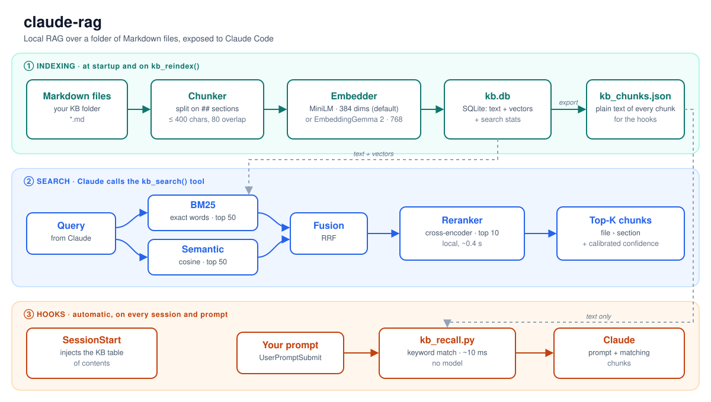

# claude-rag

**Local RAG for Claude Code over a folder of Markdown files.**

🇬🇧 English · [🇮🇹 Italiano](README.it.md)

claude-rag turns a folder of `.md` notes into a knowledge base that Claude Code can search. It runs entirely on your machine: no API keys, no cloud, no data leaving the PC.

- **Search tool**: Claude calls `kb_search("…")` and gets back the most relevant sections, each with its source file and a confidence score.
- **Automatic recall** (optional): hooks add matching notes to your prompt before Claude even sees it.
- **Measured, not guessed**: a retrieval benchmark (`eval/`) backs every default.



> 🔎 **[Interactive walkthrough: how `kb_search` finds an answer, step by step →](docs/how_search_works.html)**

---

## Contents

1. [Quick start](#quick-start)
2. [What Claude can do with it](#what-claude-can-do-with-it)
3. [How it works](#how-it-works)
4. [Choosing the embedding model](#choosing-the-embedding-model)
5. [Optional: automatic recall with hooks](#optional-automatic-recall-with-hooks)
6. [Configuration](#configuration)
7. [Measuring retrieval quality](#measuring-retrieval-quality)
8. [Project layout](#project-layout)
9. [Credits and license](#credits-and-license)

---

## Quick start

**1. Clone the repo inside your KB folder.** Your `.md` files live in the parent folder.

```bash
git clone https://github.com/sangelastro/claude-rag ~/.claude/my-kb/rag
```

**2. Install the dependencies.**

```bash
cd ~/.claude/my-kb/rag
pip install -r requirements.txt
```

**3. Register the server in Claude Code** (`~/.claude.json`, under `mcpServers`):

```json
"my-kb": {
  "command": "python",
  "args": ["/absolute/path/to/rag/server.py"]
}
```

If the repo is not inside the KB folder, add `"env": {"KB_RAG_DIR": "/absolute/path/to/your/kb"}`.

**4. Restart Claude Code.** On first start the server downloads the embedding model (~120 MB) and indexes every `.md` file. After that, only changed files are re-indexed.

---

## What Claude can do with it

| Tool | What it does |
|---|---|
| `kb_search(query, top_k=5)` | Returns the `top_k` most relevant chunks, each with file, section and score. Warns when the answer is probably not in the KB |
| `kb_reindex(force=False)` | Re-indexes the files changed since the last run (`force=True`: all of them) |
| `kb_stats()` | Files indexed, chunks per file, last update |
| `kb_savings()` | Tokens saved: chunks served vs reading the whole files, split by tool and hook |

---

## How it works

The picture above has three parts.

**① Indexing**, at startup and on `kb_reindex()`
1. Each `.md` file is split on its `##` sections. Long sections become overlapping chunks (400 characters, 80 shared with the next one). YAML frontmatter is dropped; every chunk keeps a header with its file and section.
2. Every chunk is turned into a vector by the embedding model.
3. Text and vectors go into `kb.db` (SQLite). The plain text is also exported to `kb_chunks.json` for the hooks.
4. Only files whose modification time changed are processed again.

**② Search**, when Claude calls `kb_search()`
1. **BM25** ranks the chunks by exact words: table names, ports, hostnames, error codes.
2. **Semantic search** ranks them by meaning (cosine similarity between vectors): paraphrases and natural-language questions.
3. The two top-50 lists are merged with **Reciprocal Rank Fusion**.
4. A local **cross-encoder reranker** re-reads the best 10 together with the question and puts them in order. Its top score is turned into a **calibrated confidence**; below 0.5 Claude is told the answer is probably not in the KB.

**③ Hooks**, optional and automatic: see [below](#optional-automatic-recall-with-hooks).

---

## Choosing the embedding model

| | **MiniLM** (default) | **EmbeddingGemma 2** (optional) |
|---|---|---|
| Model | `paraphrase-multilingual-MiniLM-L12-v2` | [`google/embeddinggemma-2`](https://huggingface.co/google/embeddinggemma-2), Apache-2.0 |
| Reads per chunk | 128 tokens | 8K tokens, chunk header used as the document title |
| Vector size | 384 | 768 (can be cut to 512, 256, 128) |
| Right section in top 5 (semantic only) | 0.71 | **0.92** |
| Tells "not in the KB" apart | 69% | **93%** |
| Full reindex (6,900 chunks, 4 CPU threads) | a few minutes | ~1 hour, once |
| Per search | a few ms | ~0.5 s with the reranker |
| RAM per server | ~0.5 GB | ~2 GB |
| Runtime | fastembed (ONNX) | sentence-transformers + torch, in its own virtualenv |

Start with MiniLM. Switch to EmbeddingGemma 2 if your questions are often in natural language, or if your notes are long and full of context.

### Switching to EmbeddingGemma 2

```bash
python -m venv ~/.venvs/embgemma
~/.venvs/embgemma/Scripts/python -m pip install torch torchvision --index-url https://download.pytorch.org/whl/cpu
~/.venvs/embgemma/Scripts/python -m pip install -r requirements-gemma.txt
```

On Linux and macOS the interpreter is in `bin/` instead of `Scripts/`. Then point the server at it:

```json
"my-kb": {
  "command": "/home/you/.venvs/embgemma/Scripts/python",
  "args": ["/absolute/path/to/rag/server.py"],
  "env": {"KB_EMBED_MODEL": "embeddinggemma-2"}
}
```

Things to know:
- **The model is recorded in `kb.db`.** When it changes, the next start re-embeds the whole KB instead of mixing vectors of different sizes.
- **Every Claude Code session starts its own server.** Close or reconnect (`/mcp` → Reconnect) all open sessions after switching; a session still on the old settings would re-index the KB back to the old model.
- The server keeps only the text part of Gemma in memory (271M of 744M parameters) and runs it in fp32 on CPU: bf16 is ~2.5× slower without hardware support, fp16 is not supported by the model.

---

## Optional: automatic recall with hooks

Two Claude Code hooks add KB context without an explicit `kb_search` call. They use keyword matching on `kb_chunks.json`: ~10 ms, no model loaded.

| Hook | Script | What it does |
|---|---|---|
| `SessionStart` | `hooks/kb_session_start.py` | Adds the KB table of contents at the start of each session |
| `UserPromptSubmit` | `hooks/kb_recall.py` | Adds the best-matching chunks before each prompt, within a size budget |

Copy the sections of `hooks/hooks_example.json` into `~/.claude/settings.json` and replace the paths:

```json
{
  "hooks": {
    "SessionStart": [{"matcher": "*", "hooks": [
      {"type": "command", "command": "python /absolute/path/to/rag/hooks/kb_session_start.py"}]}],
    "UserPromptSubmit": [{"matcher": "*", "hooks": [
      {"type": "command", "command": "python /absolute/path/to/rag/hooks/kb_recall.py", "timeout": 5}]}]
  }
}
```

---

## Configuration

All settings are environment variables in the `env` block of the server (or of the hooks).

**Where the KB lives**

| Variable | Default | Meaning |
|---|---|---|
| `KB_RAG_DIR` | parent of `server.py` | Folder with the `.md` files |
| `KB_RAG_DB` | `kb.db` next to `server.py` | SQLite database |
| `KB_RAG_NAME` | `kb-rag` | MCP server name |

**Indexing and embedding**

| Variable | Default | Meaning |
|---|---|---|
| `CHUNK_MAX_CHARS` | `400` | Maximum chunk size; longer sections are split |
| `CHUNK_OVERLAP` | `80` | Characters shared by consecutive chunks |
| `KB_EMBED_MODEL` | `minilm` | `minilm` or `embeddinggemma-2`. Changing it re-embeds the whole KB |
| `KB_EMBED_DIM` | `768` | EmbeddingGemma 2 only: cut vectors to `512`, `256` or `128` |
| `KB_EMBED_THREADS` | `4` | EmbeddingGemma 2 only: CPU threads |

**Search**

| Variable | Default | Meaning |
|---|---|---|
| `KB_SEARCH_MODE` | `hybrid` | `hybrid` (BM25 + semantic) or `semantic` (cosine only) |
| `KB_RERANK` | `mmarco-mminilm` | Reranker: `mmarco-mminilm` (AVX-512), `mmarco-mminilm-avx2` (older CPUs), `bge-m3` (slower, not calibrated) or `off`. If it cannot load, search continues without it |
| `KB_RERANK_CANDIDATES` | `10` | Candidates passed to the reranker |
| `KB_RERANK_THREADS` | `4` | Reranker CPU threads |
| `KB_RERANK_CACHE` | `~/.cache/claude-rag/models` | Where reranker models are downloaded |
| `KB_MIN_CONFIDENCE` | `0.5` | Below this confidence `kb_search` warns that the answer is probably not in the KB |

**Hooks**

| Variable | Default | Meaning |
|---|---|---|
| `KB_RAG_HOOK_TOP_K` | `3` | Maximum chunks added per prompt |
| `KB_RAG_HOOK_MIN_SCORE` | `0.15` | Minimum score to add anything |
| `KB_RAG_HOOK_MIN_WORDS` | `4` | Prompts shorter than this are skipped |
| `KB_RAG_HOOK_TOKEN_BUDGET` | `6000` | Maximum characters added (~4 characters per token) |

---

## Measuring retrieval quality

`eval/eval_retrieval.py` checks how often the right section comes back, on a set of real questions labelled with their correct file and section. It compares every stage of the pipeline, only reads `kb.db` and records nothing.

```bash
cp eval/gold_set.example.json eval/gold_set.json   # then write questions about your KB
python eval/eval_retrieval.py              # add --no-rerank to skip the reranker
```

Add some questions the KB cannot answer (`"kind": "neg"`): the script also reports whether a score threshold tells them apart. `--calibrate` fits the reranker's confidence on your own data. `KB_EVAL_GOLD` and `KB_RAG_DB` point it to another gold set or database.

Results on the author's KB (6,885 chunks, 48 answerable and 7 unanswerable questions, October 2026). The cells show how often the right section is first / in the top 5, then the MRR:

| Pipeline | MiniLM | EmbeddingGemma 2 |
|---|---|---|
| semantic only | 0.58 / 0.71 · 0.65 | **0.69 / 0.92 · 0.80** |
| hybrid (BM25 + semantic) | 0.65 / 0.83 · 0.74 | **0.73 / 0.90 · 0.81** |
| hybrid + reranker (default) | 0.77 / 0.92 · 0.83 | **0.79** / 0.90 · 0.83 |

How each stage got here, release by release, is in the [CHANGELOG](CHANGELOG.md).

---

## Project layout

```
rag/
├── server.py                  MCP server: indexing, hybrid search, tools
├── reranker.py                Local cross-encoder and calibrated confidence
├── requirements.txt           Default dependencies (fastembed)
├── requirements-gemma.txt     Extra dependencies for EmbeddingGemma 2
├── hooks/
│   ├── kb_session_start.py    SessionStart hook
│   ├── kb_recall.py           UserPromptSubmit hook
│   └── hooks_example.json     Hook configuration template
├── eval/
│   ├── eval_retrieval.py      Retrieval benchmark
│   └── gold_set.example.json  Gold set format (yours stays local)
└── docs/
    ├── architecture.svg       The diagram above (architecture.it.svg in Italian)
    └── how_search_works.html  Interactive walkthrough of kb_search
```

`kb.db`, `kb_chunks.json`, `eval/gold_set.json` and `eval/results.json` are created locally and excluded from git, because they contain your notes.

`architecture.html` and `kb_rag_slides.html` are older presentations written for release 1.3: they do not cover EmbeddingGemma 2.

---

## Credits and license

The RAG system (chunking, embedding, SQLite vector store, MCP server, hybrid search, reranking, evaluation) is original work by [Sergio Angelastro](https://github.com/sangelastro), released under the [MIT License](LICENSE).

The hook system is inspired by [agd-memory](https://github.com/Pinperepette/agd-memory) by [@Pinperepette](https://github.com/Pinperepette) (MIT): see [CREDITS.md](CREDITS.md).
